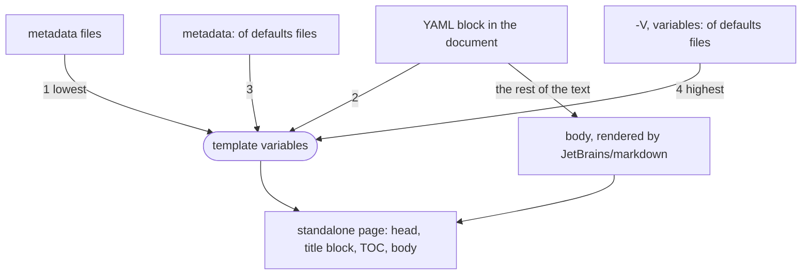
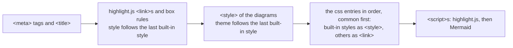

# jetbrains-markdown-cli

A replacement for [pandoc](https://pandoc.org/) for converting Markdown to HTML, built on the
[JetBrains/markdown](https://github.com/JetBrains/markdown) library.

It is aimed at developers who want to generate the same HTML that the JetBrains IDEs show in their Markdown preview
(and produce with *Export to HTML*), e.g. in build scripts and CI, without an IDE. The command line follows pandoc
(input and output handling, `--standalone`, `--variable`, `--defaults`, `--metadata-file`), but the Markdown is parsed
and rendered by JetBrains/markdown, and the output is shaped like the IDE's, not like pandoc's. It is not a drop-in
replacement for all of pandoc, see [Limitations](#limitations).

Converts Markdown files to HTML, with the input and output handled like in [pandoc](https://pandoc.org/MANUAL.html#using-pandoc):

```sh
jetbrains-markdown-cli -o hello.html hello.md   # file to file
jetbrains-markdown-cli chap1.md chap2.md        # several files, concatenated with blank lines between them; HTML on stdout
```

Without input files Markdown is read from stdin, and without `-o` the HTML is written to stdout, which needs no mounts
in a container. The file name `-` also stands for stdin (as an input) and stdout (as the `-o` argument):

```sh
echo '# Hello *world*' | jetbrains-markdown-cli
# <h1 id="hello-world">Hello <em>world</em></h1>
echo '# Hello *world*' | jetbrains-markdown-cli intro.md - -o -   # intro.md, then stdin, to stdout
```

The output is indented, and headings get `id`s computed like in IntelliJ's Markdown preview.

With `-s`/`--standalone` the output is a complete HTML document (like `pandoc --standalone`) instead of just the content:

```sh
echo '# Hello *world*' | jetbrains-markdown-cli --standalone
# <!DOCTYPE html>
# <html>
#   <head>
#     <meta charset="UTF-8">
#     <title>Hello *world*</title>
#     <style>…</style>
#     <style>…</style>
#   </head>
#   <body>
#     <h1 id="hello-world">Hello <em>world</em></h1>
#   </body>
# </html>
```

The `<title>` is the `title` [template variable](#template-variables), or else the text of the first heading.
The two `<style>`s (abbreviated here) are the [`common` rules and the default style](#styles), which `-V css=none` leaves out.

## Options

| Option                         | Description |
|--------------------------------|-------------|
| `INPUT...`                     | The Markdown files to convert. They are concatenated, with a blank line between them, before parsing (so a YAML metadata file can be one of them, like in pandoc). Stdin if there are none; `-` is stdin |
| `-o`, `--output=FILE`          | Write the HTML to `FILE` (replacing it) instead of stdout; `-` is stdout. Nothing is written if the conversion fails |
| `-s`, `--standalone`           | Produce a complete HTML document (doctype, `<head>`, `<body>`) instead of just the content |
| `--toc`, `--table-of-contents` | Add a [table of contents](#table-of-contents) of the headings after the title block (with `--standalone`, as in pandoc) |
| `--toc-depth=NUMBER`           | The heading levels the table of contents covers, 1 to 6 (default 3) |
| `-f`, `--flavour=...`          | Markdown flavour: `gfm` (default, GitHub Flavored Markdown like IntelliJ's Markdown plugin), `commonmark` (plain CommonMark) or `space` (JetBrains Space) |
| `--raw-html`, `--no-raw-html`  | HTML in the Markdown (blocks and tags in the text, also in the values of variables) is passed on to the output, which is what Markdown does and the default, or with `--no-raw-html` shown as text, like pandoc's `-f markdown-raw_html`: HTML blocks become paragraphs, and a `<style>` in a sentence cannot hide the rest of the page. Use it for text that only mentions tags, such as a changelog, and for untrusted Markdown |
| `-V`, `--variable=KEY[=VAL]`   | Set a template variable like `pandoc --variable`: without a value it is `true`, repeating a key makes a list. Can be repeated |
| `-d`, `--defaults=FILE`        | Read options from a YAML defaults file like `pandoc --defaults` (`input-files`, `output-file`, `standalone`, `flavour`, `toc` or `table-of-contents`, `toc-depth`, `raw-html`, `variables`, `metadata`, `metadata-files`; other keys are ignored with a warning). `FILE.yaml` is found as `FILE`. Can be repeated, later files override earlier ones, the command line overrides them all (input files on the command line replace those of defaults files, like in pandoc) |
| `--metadata-file=FILE`         | Read metadata (a YAML mapping) from `FILE`. Can be repeated, later files override earlier ones |
| `-v`, `--version`              | Show the version and exit; `--help` shows it too |
| `-h`, `--help`                 | Show the help and exit |

```sh
printf '| a |\n|---|\n| 1 |\n' | jetbrains-markdown-cli --flavour commonmark   # no <table>
```

## Template variables

Like in pandoc, the document skeleton of `--standalone` output has template variables, which can be set in four ways
(highest precedence first):

| Method | Example |
|--------|---------|
| `-V`/`--variable` on the command line, or `variables:` in a [defaults file](https://pandoc.org/MANUAL.html#default-files) | `-V title="My document"` |
| `metadata:` in a defaults file | `metadata: {title: My document}` |
| A [YAML metadata block](https://pandoc.org/MANUAL.html#extension-yaml_metadata_block) in the document (not part of the output) | `---`, `title: My document`, `---` at the start of the input |
| `--metadata-file` on the command line, or `metadata-files:` in a defaults file | `--metadata-file meta.yaml` |

```sh
printf -- '---\ntitle: My *document*\n---\n\n# Hello\n' | jetbrains-markdown-cli --standalone | grep title
#     <title>My document</title>
printf '# Hello\n' | jetbrains-markdown-cli --standalone -V 'title=Mine & yours' | grep title
#     <title>Mine &amp; yours</title>
```



Within a method, later settings override earlier ones, and a field of a later layer replaces the whole field of an
earlier one. The command line overrides defaults files, for variables as well (pandoc would append the command line
values to a list).

### Supported variables

| Variable | Used for |
|----------|----------|
| `title`  | The `<title>`, as plain text: it is Markdown, so `My *title*` becomes `My title`. Without it the text of the first heading is used. Also starts the title block in the `<body>`, which only exists with a `title` |
| `subtitle` | `<p class="subtitle">` in the title block (Markdown inlines) |
| `author` | `<p class="author">` in the title block, one per author, and a `<meta name="author">` in the `<head>`. A list gives several authors; a map is its `name` |
| `date`   | `<p class="date">` in the title block (Markdown inlines) and `<meta name="dcterms.date">` in the `<head>` |
| `abstract` | `<div class="abstract">` in the title block, titled `abstract-title` (default `Abstract`). It is Markdown blocks |
| `lang`   | The `lang` attribute of `<html>` |
| `toc`, `toc-title` | The [table of contents](#table-of-contents) |
| `css`    | The [styles](#styles) of the page: built-in ones by name, or the URLs of stylesheets. A list gives several. Without it, the `default` style is used |
| `highlight`, `highlight-style`, `highlight-style-dark`, `highlight-url`, `highlight-languages` | [Syntax highlighting](#syntax-highlighting) of code fences with highlight.js |
| `mermaid`, `mermaid-theme`, `mermaid-theme-dark`, `mermaid-url` | [Diagrams](#diagrams): `mermaid` code fences rendered by Mermaid |

The title block is like the one of pandoc's HTML template:

```sh
printf -- '---\ntitle: My document\nauthor: [Ann, Bob]\ndate: 2026-01-02\n---\n' | jetbrains-markdown-cli --standalone -V lang=en
# <!DOCTYPE html>
# <html lang="en">
#   <head>
#     <meta charset="UTF-8">
#     <meta name="author" content="Ann">
#     <meta name="author" content="Bob">
#     <meta name="dcterms.date" content="2026-01-02">
#     <title>My document</title>
#     <style>…</style>
#     <style>…</style>
#   </head>
#   <body>
#     <header id="title-block-header">
#       <h1 class="title">My document</h1>
#       <p class="author">Ann</p>
#       <p class="author">Bob</p>
#       <p class="date">2026-01-02</p>
#     </header>
#   </body>
# </html>
```

### Table of contents

`--toc` (or `--table-of-contents`) adds a table of contents to a `--standalone` document, like pandoc: a `<nav id="TOC"
role="doc-toc">` with the headings as nested lists, after the title block and before the content. The links point to the
`id`s of the headings, which are the IDE's (not pandoc's). Links in a heading
are left out of its entry, other formatting stays. `--toc-depth=N` (default 3) sets the deepest heading level.

```sh
printf '# One\n\n## Two\n' | jetbrains-markdown-cli --standalone --toc -V toc-title=Contents | sed -n '/<body>/,/<\/nav>/p'
#   <body>
#     <nav id="TOC" role="doc-toc">
#       <h2 id="toc-title">Contents</h2>
#       <ul>
#         <li><a href="#one" id="toc-one">One</a>
#           <ul>
#             <li><a href="#two" id="toc-two">Two</a></li>
#           </ul>
#         </li>
#       </ul>
#     </nav>
```

The template variables work as in pandoc's template, which has some surprises:

- `toc-title` is the text of the `<h2>`; without it there is no title.
- The variable `toc` only decides whether the `<nav>` is there, the entries come from `--toc` (or `toc: true`/`toc-depth` in a
  [defaults file](#options), which are options and not variables). So `-V toc`, or `toc: true` in the document's YAML block,
  without `--toc` gives an empty `<nav>`, and `toc-depth` as a variable or in the metadata does nothing.
- With `--toc`, `toc` is set for you unless there are no headings (then there is no `<nav>`) or you set it yourself: `toc: false`
  in the YAML block or `metadata:` turns the table off, while `-V toc=false` is the text `false`, which is true.
  An empty value is false. Like in a pandoc template, a list is true if one of its items is, and a map always.

### Styles

The `css` variable is a list like in pandoc's template, but besides the URLs of stylesheets, which become
`<link rel="stylesheet" href="...">`, it knows built-in styles, which are put into the `<head>` as a `<style>` element
(so the document stays self-contained) when named:

| Name       | Style |
|------------|-------|
| `none`     | No style at all, not even `common`: it turns off what would be added on its own |
| `common`   | Base rules that fit under any style: for printing, no page break inside table rows, images, code blocks, list items and quotes, none right after a heading, at least 3 lines of a paragraph on a page, and long lines of code wrap instead of being cut off; and images and SVGs never wider than the page. No colours, fonts or sizes. It is added in front of every `css` list on its own, see below |
| `default`  | The style used without `css`; the same as `intellij` for now |
| `intellij` | The style of the IntelliJ Markdown preview: its `default.css` with the colours of the IDE's light and dark themes (picked by the browser's `prefers-color-scheme`, not by an IDE setting) |
| `github`   | GitHub's look, based on [github-markdown-css](https://github.com/sindresorhus/github-markdown-css), light and dark as well |
| `gitlab`   | GitLab's look, from GitLab's Markdown CSS and the design tokens of GitLab UI, light and dark as well |
| `pandoc`   | The look of the page `pandoc --standalone` makes without a stylesheet: pandoc's default CSS (3.7), light only |

```sh
printf '# Hello\n' | jetbrains-markdown-cli -s -V css=github            # the GitHub style
printf '# Hello\n' | jetbrains-markdown-cli -s -V css=gitlab            # the GitLab style
printf '# Hello\n' | jetbrains-markdown-cli -s -V css=pandoc            # the style of pandoc's own pages
printf '# Hello\n' | jetbrains-markdown-cli -s -V css=none              # no style at all
printf '# Hello\n' | jetbrains-markdown-cli -s -V css=common            # only the base rules
printf '# Hello\n' | jetbrains-markdown-cli -s -V css=github -V css=my.css   # GitHub's, then yours, which can override it
printf '# Hello\n' | jetbrains-markdown-cli -s -V css=my.css               # the base rules, then yours
printf '# Hello\n' | jetbrains-markdown-cli -s -V css=none -V css=my.css     # only yours
printf '# Hello\n' | jetbrains-markdown-cli -s -V css=github -V css=common   # common after GitHub's, where you want it
```

The names are exact (`GitHub` or `./github` are file names). Styles come in the order of the list, so later ones
override earlier ones. A `css` without any value stands for the `default` style, `none` is the way to turn it off.
Styles are only added with `--standalone`.

The `common` style is always first, as if the list began with `common` (`css=github` is `css=common, css=github`, and
`css=my.css` is `css=common, css=my.css`), so the built-in styles and yours can override it. It is not added if the list
has `none` anywhere (`css=none, css=my.css` is only yours) or has `common` itself, which then stays where you put it.
`css=common` alone is just these rules, without the default style. Like the other built-in styles, `common` is
a `<style>` element.

The wrapping of code in print is the one rule that the built-in styles would override with equal specificity, so its
selectors are `html pre` and `html pre code`: a selector of yours with a class or id (`.post pre`) wins over it.

The `<head>` is put together in this order, so what comes later overrides what comes before. The
[highlight.js](#syntax-highlighting) and [Mermaid](#diagrams) parts are only there with `-V highlight` and `-V mermaid`;
their default look follows the last built-in style of `css` (`common` does not count, it has no look):



#### Web fonts

The fonts of these styles are mostly not installed on a normal system, and browsers do not give a page access to all
local fonts, so the built-in styles bring the ones they need as `@font-face` rules with links to `woff2` files on
[jsDelivr](https://www.jsdelivr.com/) (pinned versions, all licensed under the OFL-1.1). A browser only fetches a file when
the page needs it, and shows the text in the next font of the stack until it is there (`font-display: swap`).

| Style | Web fonts | Where the font stack uses them |
|-------|-----------|--------------------------------|
| `gitlab` | GitLab Sans and GitLab Mono, from the [`@gitlab/fonts`](https://www.npmjs.com/package/@gitlab/fonts) package of GitLab | first, like on gitlab.com |
| `github` | [Noto Sans](https://fontsource.org/fonts/noto-sans) (Latin, Latin Extended, Cyrillic and Greek) | after the system fonts (`-apple-system`, Segoe UI, an installed Noto Sans), so macOS and Windows keep theirs |
| `intellij` | JetBrains Mono (from `@gitlab/fonts`, which carries the official files) for code, and [Arimo](https://fontsource.org/fonts/arimo), which has the metrics of Arial and Helvetica, as the last sans-serif font | JetBrains Mono first as in the IDE; Arimo only where neither Helvetica, Arial nor FreeSans exist |
| `pandoc` | none | its stack is generic (`sans-serif`, `monospace`...) |

Helvetica and Arial themselves are proprietary and not available as web fonts, which is why `intellij` falls back to Arimo.
The code font of `github` (`ui-monospace`, SF Mono, Menlo, Consolas, Liberation Mono) stays the system's.

So a page with one of these styles contacts the CDN when it is opened, unlike the pages with `css=none` or `css=pandoc`.
Offline, or with the CDN blocked, nothing breaks: the page uses the fallback fonts. To avoid the requests, use your own
stylesheet (`-V css=none -V css=my.css`).

### Syntax highlighting

With `-V highlight` (or `highlight=true`; `false` is off, which is the default, and anything else is an error) the code
fences that have a language are highlighted in the browser by [highlight.js](https://highlightjs.org/), which is loaded
from a CDN: the page then needs the network (or your own copy, see `highlight-url`), and without JavaScript the code
stays plain. The output of the fences does not change, highlight.js finds `<code class="language-kotlin">` itself. Only
fences with a language are highlighted (highlight.js would guess one for the others), and languages it does not know,
such as `mermaid` (see [Diagrams](#diagrams)), stay plain without a message in the console.

```sh
jetbrains-markdown-cli -s -V highlight README.md                                    # the style fits the css style
jetbrains-markdown-cli -s -V highlight -V highlight-style=monokai-sublime README.md
jetbrains-markdown-cli -s -V highlight -V highlight-languages=dockerfile -V highlight-languages=nginx README.md
jetbrains-markdown-cli -s -V highlight -V highlight-url=vendor/highlightjs README.md   # your own copy
```

| Variable | Meaning |
|----------|---------|
| `highlight` | Turns it on |
| `highlight-style` | The name of a [highlight.js style](https://highlightjs.org/examples) (`github`, `monokai-sublime`, `base16/solarized-light`, ...) or the URL of a stylesheet (it ends in `.css` or has a `://`). Without it, see below. Used for light and dark unless `highlight-style-dark` is set |
| `highlight-style-dark` | The style for `prefers-color-scheme: dark`; `highlight-style` (or the derived light style) is then the one for light |
| `highlight-url` | Where highlight.js comes from, by default `https://cdn.jsdelivr.net/npm/@highlightjs/cdn-assets` (the latest release of the official package; add `@11` or an exact version to pin it). Either a directory with `highlight.min.js`, `styles/NAME.min.css` and `languages/NAME.min.js` (also what cdnjs and unpkg have, or a local copy), or the URL of the script, whatever it is called, with `styles/` next to it |
| `highlight-languages` | More languages to load, from `languages/NAME.min.js`. The script has the common ones (about 40, among them `kotlin`, `bash`, `json`, `yaml`, `xml`, `sql`); `dockerfile`, `nginx`, `powershell` and the like have to be named |

The default style follows the [style of the page](#styles), the last built-in one in `css`:

| `css` | Light | Dark |
|-------|-------|------|
| `default`, `intellij` | `idea` | `androidstudio` |
| `github` | `github` | `github-dark` |
| `gitlab` | `github` | `base16/tomorrow-night` |
| `pandoc` | `github` | none, as that page is not dark |
| `none` or only your own stylesheets | `github` | none, as those pages are not dark |

Since the light and dark styles are each linked with a `prefers-color-scheme` media query, they follow the browser, like
the built-in styles. With `css=none` the highlight style still applies; it gives the code its own box.

Conflicts with the styles of `css` are avoided like this:

- The `<link>`s of highlight.js come first in the `<head>`, then the `css` entries in order, then the scripts. So every
  entry of `css`, yours too, can override highlight.js, and the scripts are the last thing loaded.
- highlight.js styles give code their own padding, background and text colour. With a built-in style and the derived
  highlight style, a few rules next to the links make the code use the box of the page's `<pre>`, so there is just one.
  If you choose a `highlight-style` it is the other way round: the theme's box is used (a dark theme such as `monokai-sublime`
  stays readable on the light page). Without a built-in style nothing is added.
- `css` and `highlight-style` are different things: `css=github` is the page style, not a highlight.js style.
- The names are the file names of highlight.js (letters, digits, `.`, `_`, `-`, and `/` in style names); anything else is an error.

`highlight-url` decides which script runs on the page. A document with a YAML metadata block can set it like any
other variable, so do not render untrusted Markdown with `highlight` unless you set `highlight-url` (and
`-V` wins over the document), ideally pinned to an exact version.

### Diagrams

With `-V mermaid` (or `mermaid=true`; `false` is off, which is the default, and anything else is an error) the code
fences of the language `mermaid` are drawn as diagrams in the browser by [Mermaid](https://mermaid.js.org/), which is
loaded from a CDN: the page then needs the network (or your own copy, see `mermaid-url`; the script is several MB), and
without JavaScript the diagram stays a code block with its source. The output of the fences does not change, the script
finds `<code class="language-mermaid">` itself and replaces the code block with the SVG. A diagram Mermaid cannot parse
stays a code block, without an error drawing.

````sh
printf '```mermaid\ngraph TD\n  A --> B\n```\n' | jetbrains-markdown-cli -s -V mermaid
jetbrains-markdown-cli -s -V mermaid -V mermaid-theme=forest README.md
jetbrains-markdown-cli -s -V mermaid -V mermaid-url=vendor/mermaid README.md   # your own copy
````

| Variable | Meaning |
|----------|---------|
| `mermaid` | Turns it on |
| `mermaid-theme` | One of Mermaid's themes: `default`, `neutral`, `dark`, `forest`, `base`; anything else is an error. Without it, see below. Used for light and dark unless `mermaid-theme-dark` is set |
| `mermaid-theme-dark` | The theme for `prefers-color-scheme: dark`; `mermaid-theme` (or `default`) is then the one for light |
| `mermaid-url` | Where Mermaid comes from, by default `https://cdn.jsdelivr.net/npm/mermaid/dist` (the latest release of the official package; add `@11` or an exact version to the package name to pin it). Either a directory with `mermaid.min.js` (also what cdnjs and unpkg have, or a local copy), or the URL of the script, whatever it is called. It has to be the classic script (`mermaid.min.js`), not the ES module |

Without `mermaid-theme`, the diagrams use `default` on a light page (`neutral` with `css=gitlab`, like on gitlab.com), and `dark`
when the browser prefers a dark colour scheme and one of the built-in styles `default`, `intellij`, `github` or `gitlab` of
`css` is used (those are light and dark, see [Styles](#styles)). With `css=pandoc`, `css=none` or only your own stylesheets the
page is not known to be dark, so there is just `default`. Mermaid puts the theme into the SVG,
so the diagrams are drawn again when the browser switches.

The diagrams are `<div class="mermaid">`, not `<pre>`, so the box of code blocks does not apply to them. The
`<style>` for them comes before the `css` entries and the scripts after, like with [highlighting](#syntax-highlighting),
and the two work together.

The diagrams above in this README are Mermaid fences too: `jetbrains-markdown-cli -s -V mermaid README.md` draws them (GitHub
draws them itself).

`mermaid-url` decides which script runs on the page: as with `highlight`, do not render untrusted Markdown with
`mermaid` unless you set `mermaid-url` (and `-V` wins over the document), ideally pinned to an exact version.

Not (yet) like pandoc: `--file-scope`, the `sourcefile`/`outputfile` variables, `-M`/`--metadata`, `pagetitle`, `title-prefix`, `dir`, the other `<meta>` tags of pandoc's template, and finding defaults files in
the user data directory. Variables are escaped when inserted into the HTML, while pandoc inserts `--variable` values as they are.

## Limitations

### Compared to the JetBrains IDEs

The HTML aims to be as close as sensible to the IDE's Markdown → HTML export, minus what only makes sense in the IDE.
Missing:

- **Syntax highlighting** of code fences by the IDE's lexers and editor colour scheme, which cannot be reused here.
  Fences are emitted as `<code class="language-xyz">`, and [`-V highlight`](#syntax-highlighting) adds highlight.js, which has its
  own tokens and colours and needs a CDN or a local copy. Another client-side highlighter such as Prism can be added by hand.
- **Diagram and formula rendering**, such as PlantUML and LaTeX math. The IDE renders them in its browser
  preview through extensions; here the fence is emitted as a plain code block, with the same `language-` class.
  Only Mermaid is supported, in the browser, with [`-V mermaid`](#diagrams), which needs a CDN or a local copy.
- **Scripts and the IDE's look**: no JavaScript and no Content-Security-Policy `<meta>`. The [styles](#styles) are
  made from the IDE's preview style but fixed to the IntelliJ Light and Dark themes (switched by the browser), not the
  colours of your editor colour scheme or font size, and there is no IDE setting for a custom stylesheet (use `css`).
- **Fonts** of the `intellij`, `github` and `gitlab` styles are fetched from a CDN when the page is opened (see [web fonts](#web-fonts)),
  and fall back to the system's fonts without network.
- **Preview-only markup**: `md-src-pos` attributes, per-line `<span>`s in paragraphs, and the copy/run buttons on code fences.
- **Relative links** are left as they are; the IDE resolves them to `file:` URLs.

Heading `id`s, indentation of the output and the default GitHub Flavored Markdown (`--flavour gfm`) do match the IDE.

### Compared to pandoc

pandoc is much bigger, this tool only converts Markdown to HTML:

- **Template variables**: only the [variables listed above](#template-variables) (`title`, `subtitle`, `author`, `date`, `abstract`, `lang`, `css`, `toc`, `toc-title`, `highlight*`, `mermaid*`) are
  used by the `--standalone` skeleton. Other variables that pandoc's default HTML template knows (`header-includes`, `include-before`, `include-after`, `keywords`, `math`, ...) can be set, but have no
  effect. There is no
  `--template` option either, so the skeleton cannot be replaced.
- **Options**: no `-M`/`--metadata`, `--css`, `-H`/`-B`/`-A` (includes), `--wrap`, `--highlight-style` (it is the variable `highlight-style` here, for highlight.js, and highlighting is off by default,
  while pandoc highlights on its own, with skylighting),
  `--mathjax`/`--katex`, `--filter`/`--lua-filter`, `--citeproc`, `--file-scope`, `--resource-path` or `--self-contained`.
  Keys of a [defaults file](#options) that are not supported are ignored with a warning.
- **Other formats**: Markdown is the only input and HTML the only output; no `-f`/`-t` selection of formats and no
  `--extension` switches (`-f` here selects the JetBrains Markdown flavour; only `raw_html` has its own option, `--no-raw-html`).
- **Markdown dialect**: the parser is JetBrains/markdown (CommonMark/GFM), not pandoc's Markdown. pandoc extensions such
  as footnotes, definition lists, `smart` typography, citations, attributes (`{#id .class}`), fenced divs and
  `tex_math_dollars` are not supported.
- **Output**: differs in details from pandoc's, e.g. the heading `id`s, the indentation, and the code fence markup
  (`<pre><code class="language-xyz">` instead of pandoc's `<div class="sourceCode">` with highlighting spans). The `<head>` has no
  `generator`, `viewport` or `description` `<meta>` and the `<html>` element no `xmlns`/`xml:lang`.

## Building this page

The repository documents itself with itself. The README starts with a YAML metadata block (`title`, `subtitle`,
`author`, `abstract`), which is not part of the output and fills the title block of the standalone page.
[`docs/defaults.yaml`](docs/defaults.yaml) is a [defaults file](#options) that names the README as input and
`README.html` as output, turns on `--standalone`, `--toc`, [`highlight`](#syntax-highlighting) and
[`mermaid`](#diagrams), and points to [`docs/metadata.yaml`](docs/metadata.yaml), a metadata file that sets the
`github` [style](#styles), `lang` and `toc-title`. Run it from the repository root, the paths in a defaults file are
relative to the working directory:

```sh
jetbrains-markdown-cli -d docs/defaults                  # writes README.html (not committed), links in it keep working
jetbrains-markdown-cli -d docs/defaults -V css=gitlab    # -V beats the metadata file: the same page in the GitLab style
```

## GitHub Action

The repository is also a GitHub Action, so a workflow can convert Markdown to HTML without building anything: it downloads the
binary of a [release](../../releases) for the runner (Linux, macOS and Windows, amd64 and arm64 where the
[downloads](#downloads) exist), runs it, and leaves `jetbrains-markdown-cli` on the `PATH` for the steps after it.

```yaml
name: Docs
on:
  push:
    branches: [main]

jobs:
  pages:
    runs-on: ubuntu-latest
    steps:
      - uses: actions/checkout@v7

      - name: Convert the README to HTML
        uses: jetbrains-markdown-cli/jetbrains-markdown-cli@v1
        with:
          input-files: README.md
          output-file: public/index.html
          toc: true
          variables: |
            css=github
            highlight
            mermaid

      # Chrome is on the runner. The virtual time budget gives highlight.js and Mermaid, which the page loads from
      # a CDN, time to run before the page is printed.
      - name: Print the HTML to PDF
        run: |
          google-chrome --headless --no-sandbox --no-pdf-header-footer --virtual-time-budget=30000 \
            --print-to-pdf=public/README.pdf "file://$PWD/public/index.html"

      - uses: actions/upload-artifact@v7
        with:
          name: docs
          path: public
```

The same two steps, with a defaults file, run in this repository's own release workflow (`.github/workflows/build.yml`):
`README.pdf` is [attached to every release](../../releases) next to the binaries, made from the page of
[Building this page](#building-this-page). `CHANGELOG.pdf` is attached as well, made the same way but with the
[container image](#container-image) instead of the action.

| Input | Meaning |
|-------|---------|
| `input-files` | The Markdown files, one per line; they are concatenated like on the command line. Needed unless a defaults file names them |
| `output-file` | The HTML file to write (its directory is created). Needed unless a defaults file names it, otherwise the HTML goes to the log |
| `defaults`, `metadata-files` | [Defaults files](#options) and metadata files, one per line |
| `standalone` | `true` (default) for a complete document, `false` for just the content |
| `toc`, `toc-depth`, `flavour` | The options of the same name |
| `variables` | [Template variables](#template-variables), one `KEY` or `KEY=VALUE` per line |
| `args` | More command line arguments, one per line |
| `version` | The release to use: `1.0.0`, `v1.0.0` or `latest` (default) |
| `working-directory` | The directory the paths of the other inputs are relative to (default `.`) |

The outputs are `output-file` (as given) and `version` (the version that ran). `@v1` is the latest release `1.x`, which every
release moves; use `@v1.2.3` or a commit to pin the action itself, and `version` to pin the binary, which is otherwise the
latest release no matter which version of the action runs. Untrusted Markdown needs the precautions
of [`highlight`](#syntax-highlighting) and [`mermaid`](#diagrams) as well.

## Container image

For GitLab CI, and anywhere else that runs containers, there is an image with the binary on the `PATH`:
`ghcr.io/jetbrains-markdown-cli/jetbrains-markdown-cli`, for `linux/amd64` and `linux/arm64`, based on Debian (the binary needs
glibc, and GitLab CI needs a shell in the image). Every [release](../../releases) is published as `1.2.3`, `1.2`, `1` and `latest`:
pin the exact version (or the digest) for reproducible builds. The image only converts, it has no browser: for a PDF, see below.

It has no entrypoint, so the command is part of the call, and it runs as root with `/work` as the working directory:

```sh
echo '# Hello *world*' | docker run --rm -i ghcr.io/jetbrains-markdown-cli/jetbrains-markdown-cli:1 jetbrains-markdown-cli
docker run --rm -v "$PWD:/work" --user "$(id -u):$(id -g)" ghcr.io/jetbrains-markdown-cli/jetbrains-markdown-cli:1 \
  jetbrains-markdown-cli -s --toc -V css=github -o README.html README.md
```

The second call writes `README.html` as you, not as root. With rootless `podman`, root in the container already is you; to use `--user`
there as well, add `--userns=keep-id`, and on SELinux hosts `:Z` to the volume (`-v "$PWD:/work:Z"`).

### GitLab CI

An `image:` with the tool needs no installation step. A pipeline that converts the README and prints the page to a PDF has two
jobs, because the PDF needs a browser, which is a different image: the first job's `public/` is passed on as an artifact.

```yaml
stages: [convert, pdf]

html:
  stage: convert
  image: ghcr.io/jetbrains-markdown-cli/jetbrains-markdown-cli:1
  script:
    - mkdir -p public # like pandoc, the tool does not create directories
    - jetbrains-markdown-cli --standalone --toc -V css=gitlab -V highlight -V mermaid -o public/index.html README.md
  artifacts:
    paths: [public]

pdf:
  stage: pdf
  image: docker.io/library/debian:stable-slim
  needs: [html]
  script:
    - apt-get update -qq
    - apt-get install -y -qq --no-install-recommends chromium fonts-liberation
    # --no-sandbox, as the job runs as root in a container. The virtual time budget gives highlight.js and Mermaid, which the
    # page loads from a CDN, time to run before the page is printed.
    - >
      chromium --headless --no-sandbox --disable-gpu --disable-dev-shm-usage --no-pdf-header-footer
      --virtual-time-budget=30000 --print-to-pdf=public/README.pdf "file://$PWD/public/index.html"
  artifacts:
    paths: [public/README.pdf]
```

Things to know:

- The image has no `ENTRYPOINT`, so `image:` needs nothing more than its name (with an entrypoint, every job would need
  `entrypoint: [""]`). The jobs of GitLab's docker executor run as the image's user, which is root here, so the tool can write to the
  project directory.
- The `pdf` job installs Chromium into a plain Debian image. Any other image with Chrome or Chromium works, as long as it runs as
  root (or can write to the project directory) and has a shell; the command is `google-chrome` in the Chrome packages.
- Like with the [action](#github-action), the page loads highlight.js, Mermaid and the web fonts of the styles from a CDN, so the
  runner needs network access. For a runner without it, use your own copies (`highlight-url`, `mermaid-url`, a `css` of your own).
- Untrusted Markdown needs the precautions of [`highlight`](#syntax-highlighting) and [`mermaid`](#diagrams) here as well.
- This repository's release workflow uses the image the same way: [`CHANGELOG.pdf`](../../releases) is made from
  [`docs/changelog.yaml`](docs/changelog.yaml), a defaults file like the one of [this page](#building-this-page), with `docker run`
  and Chrome on the runner.

The image contains the Debian packages of its base image next to the binary, under their own licenses
(`/usr/share/doc/*/copyright`); `LICENSE` and `THIRD-PARTY` of the binary are in `/usr/share/doc/jetbrains-markdown-cli/`.

## Licenses

This project is licensed under the [Apache License 2.0](LICENSE). The binaries contain the libraries it is built with
(the Kotlin standard library and runtime, JetBrains Markdown, Clikt, snakeyaml-engine-kmp and their dependencies), and the
[built-in styles](#styles) and the heading anchors are adapted from other projects: `intellij` from the Markdown plugin of
IntelliJ IDEA, `github` from [github-markdown-css](https://github.com/sindresorhus/github-markdown-css), `gitlab` from
[GitLab](https://gitlab.com/gitlab-org/gitlab) and `pandoc` from [pandoc](https://github.com/jgm/pandoc). Their licenses
and notices are in [THIRD-PARTY](THIRD-PARTY), which is attached to each release and is also in every release archive,
next to the binary and the `LICENSE`.

## Downloads

Native binaries (no JVM required) are attached to each [release](../../releases) (changelog in [CHANGELOG.md](CHANGELOG.md), `jetbrains-markdown-cli --version` shows the version), built by GitHub Actions
for every platform the Kotlin/Native toolchain and JetBrains/markdown support:

| OS      | Architectures |
|---------|---------------|
| Linux   | amd64, arm64  |
| macOS   | amd64, arm64  |
| Windows | amd64         |

The Linux binaries are also in a [container image](#container-image) (amd64 and arm64).

Other platforms (Linux arm/i386/loong64/ppc64le/s390x/riscv64, Windows arm64) are not supported:
JetBrains/markdown publishes no Kotlin/Native artifacts for them and Kotlin/Native has no (stable) target for them.

## Building

```sh
./gradlew linkReleaseExecutableLinuxX64   # or ...LinuxArm64, ...MingwX64, ...MacosX64, ...MacosArm64
./gradlew linuxX64Test                    # run tests on the host target
```

The binary ends up in `build/bin/<target>/releaseExecutable/`. macOS targets need a macOS host.

The [container image](#container-image) is built from the binaries, not from the sources: put the Linux binary and the `LICENSE` and
`THIRD-PARTY` files of the repository in a directory named like the release archives (the build context), then build it with
`podman`/`buildah` or Docker; the [`Containerfile`](Containerfile) works with both:

```sh
d=image-context/jetbrains-markdown-cli-linux-amd64   # linux-arm64 for the other platform
mkdir -p "$d" && cp LICENSE THIRD-PARTY "$d"
cp build/bin/linuxX64/releaseExecutable/jetbrains-markdown-cli.kexe "$d/jetbrains-markdown-cli"
podman build -t jetbrains-markdown-cli -f Containerfile image-context   # or: docker build ...
```
